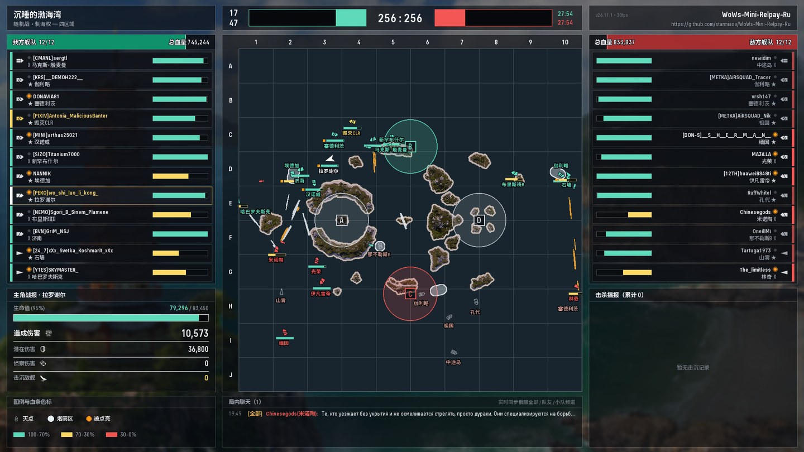

# WoWs-Mini-Relpay-Ru

**简体中文** | [繁體中文](docs/README.zh-TW.md) | [Русский](docs/README.ru.md) | [English](docs/README.en.md)

专门给俄服《战舰世界》（**Mir Korabley / Lesta**，`.korablireplay`）写的小地图回放渲染工具。  
整体画面风格参考了 [WoWs-Builder-Team/minimap_renderer](https://github.com/WoWs-Builder-Team/minimap_renderer)，但只管俄服这一套协议和资源，没有亚欧美服的历史包袱，还补上了平时复盘最常用但老工具里缺的几样东西：

- **地图烟雾**：完整还原每团烟的拉烟和消散过程，不会叠成一团黑。
- **灭点船名**：敌人灭点后在小地图上保留空心图标，同时在旁边直接标出船名，复盘走位一眼就能看明白。
- **直读汉化 mod**：自动按客户端加载顺序去读你装的汉化包（比如澪刻 LocalizedKorabli）和游戏官方图标，新船、超战都能正确显示中文名，不用手动维护船表。
- **简洁平直血条**：侧边栏参考了 Tactical-Tech 样式，去掉了船只剪影，改成 100%-70% 绿 / 70%-30% 黄 / 30%-0% 红的连续长条，沉没的船会自动掉到列表最下面并变淡，顶栏则是整条团队总血量；小地图正下方还带局内聊天区。
- **开箱即用的桌面界面**：自带免环境绿色版 EXE，打开就能自动找本机正式服和 PT 测试服目录，支持直接把 `.korablireplay` 拖进窗口批量出片，生成完自动按时间建文件夹并弹出来。
- **多语言与系统主题**：界面和渲染出来的视频都支持 **简体中文 / 繁體中文 / 俄语 / 英语**，默认跟随系统语言和系统深浅色（不在四语内自动用英语）。



---

## 普通玩家怎么用（免安装，不用装 Python）

1. 去右侧 [Releases](https://github.com/starmiaoa/WoWs-Mini-Relpay-Ru/releases) 下载 `WoWs-Mini-Relpay-Ru-win64.zip`。
2. **先解压**到任意文件夹，然后双击 `WoWs-Mini-Relpay-Ru.exe`。
3. 打开后会自动找到你装的俄服正式服 / PT 服并列出 `replays` 里的 `.korablireplay`（如果没有找到，点一下右上角「选择目录」自己指一下就行）。
4. 勾选你想生成的对局，或者把 `.korablireplay` 文件直接拖进窗口里。
5. 右边选好分辨率（默认 `1920×1080`）和帧率（默认 `30fps`），点 **「开始生成」**。
6. 等进度条走完，程序会自动打开这次按时间建好的输出文件夹，视频都在里面。

> 首次打开时程序会在后台顺手从你本地游戏目录里提取一次地图、图标和汉化词库（大概几秒钟），以后就不用再等了。  
> 想改图层开关、导出关键帧、换主题或语言，点顶部的 **「高级」** 或 **「设置」** 标签页就行。

---

## 游戏更新或者汉化 mod 更新了怎么办？

不用等工具发新版，大多数更新你本地就能直接同步：

- **游戏大版本更新后**：打开软件 → 切到 **「设置」** → 点 **「重新同步当前客户端数据」**（几秒完成）。
- **只是更新了汉化 mod 船名**：切到 **「设置」** → 点 **「仅更新汉化词库」**（1 秒完成）。

如果是非常少见的大改导致协议解析报错，可以参考 [UPDATING.md](UPDATING.md) 里的排查说明，或者直接提 Issue 并附上一局新版 `.korablireplay`。

---

## 开发者源码运行与命令行

如果你想改代码或者用命令行批量跑，推荐使用 [uv](https://docs.astral.sh/uv/)（依赖里已经自带独立 FFmpeg，不需要配系统环境变量）：

```powershell
git clone https://github.com/starmiaoa/WoWs-Mini-Relpay-Ru.git
cd WoWs-Mini-Relpay-Ru
uv sync --extra dev

# 1. 启动图形界面
.\.venv\Scripts\korabli-minimap.exe gui

# 2. 从本地俄服客户端同步数据
.\.venv\Scripts\korabli-minimap.exe sync --game-dir "D:\Games\Korabli"

# 3. 命令行直接渲染单个回放
.\.venv\Scripts\korabli-minimap.exe render "D:\Games\Korabli\replays\xxx.korablireplay" `
  -o "output\battle.mp4" --resolution 1920x1080 --fps 30 --lang zh_CN

# 4. 只解析查看战报信息（不出视频）
.\.venv\Scripts\korabli-minimap.exe inspect "D:\Games\Korabli\replays\xxx.korablireplay"

# 5. 打包免环境绿色版 EXE 与发布压缩包
.\.venv\Scripts\python.exe scripts\build_release.py

# 6. 运行自动化测试
.\.venv\Scripts\pytest.exe -v
```

---

## 致谢

- 画面布局与渲染思路参考了 [WoWs-Builder-Team/minimap_renderer](https://github.com/WoWs-Builder-Team/minimap_renderer)
- 侧边舰队面板风格参考了 BattleFrame 的 Tactical-Tech 模组
- 中文船名与字体默认读取玩家本地安装的汉化 mod（如 澪刻 LocalizedKorabli）
