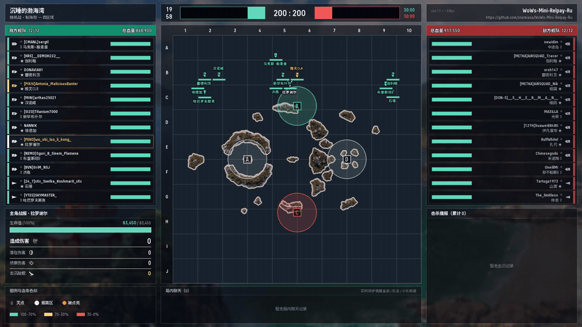

# WoWs-Mini-Relpay-Ru

[简体中文](../README.md) | [繁體中文](README.zh-TW.md) | [Русский](README.ru.md) | **English**

A minimap replay renderer built specifically for the Russian **Mir Korabley (Lesta)** client (`.korablireplay`).



---

## How to Use

1. Download `WoWs-Mini-Relpay-Ru-win64.zip` from [Releases](https://github.com/starmiaoa/WoWs-Mini-Relpay-Ru/releases).
2. **Extract** the archive to any folder, then double-click `WoWs-Mini-Relpay-Ru.exe`.
3. On launch, it automatically detects your Live / Public Test (PT) Mir Korabley installation and lists all `.korablireplay` files in `replays/` (or click **Choose Folder** in the top-right to pick it manually).
4. Check the matches you want to render, or drag and drop `.korablireplay` files directly into the window.
5. Pick your resolution (`1920×1080` default) and frame rate (`30fps` default) on the right, then click **Render**.
6. Once done, the app automatically opens the timestamped output folder containing your videos.

> On first launch, the app quietly extracts maps, official icons, and localization data from your local game folder in the background (takes a few seconds), so you won't have to wait next time.  
> To toggle minimap layers, export keyframes, or switch theme/language, open the **Advanced** or **Settings** tab at the top.

---

## What if the Game or Localization Mod Updates?

In most cases you don't need to wait for a new tool release — just sync locally:

- **After a major game patch**: Open the app → **Settings** → **Resync Client Assets** (takes a few seconds).
- **If only your localization mod updated**: Open **Settings** → **Refresh Localization Only** (takes ~1 second).

If a rare breaking protocol change causes parsing errors, see [UPDATING.md](../UPDATING.md) for troubleshooting, or open an Issue with a sample `.korablireplay` from the new version.

---

## Running from Source & CLI

If you want to tweak the code or batch-render from the command line, [uv](https://docs.astral.sh/uv/) is recommended (a standalone FFmpeg binary is already bundled in the dependencies, so no PATH setup is needed):

```powershell
git clone https://github.com/starmiaoa/WoWs-Mini-Relpay-Ru.git
cd WoWs-Mini-Relpay-Ru
uv sync --extra dev

# 1. Launch the desktop GUI
.\.venv\Scripts\korabli-minimap.exe gui

# 2. Sync assets from your local Mir Korabley client
.\.venv\Scripts\korabli-minimap.exe sync --game-dir "D:\Games\Korabli"

# 3. Render a single replay via CLI
.\.venv\Scripts\korabli-minimap.exe render "D:\Games\Korabli\replays\xxx.korablireplay" `
  -o "output\battle.mp4" --resolution 1920x1080 --fps 30 --lang en

# 4. Inspect replay diagnostics without rendering video
.\.venv\Scripts\korabli-minimap.exe inspect "D:\Games\Korabli\replays\xxx.korablireplay"

# 5. Build the portable Windows EXE and release ZIP
.\.venv\Scripts\python.exe scripts\build_release.py

# 6. Run automated tests
.\.venv\Scripts\pytest.exe -v
```

---

## Credits

- Overall layout and rendering concept inspired by [WoWs-Builder-Team/minimap_renderer](https://github.com/WoWs-Builder-Team/minimap_renderer)
- Team side-panel style inspired by BattleFrame's Tactical-Tech mod
- Localized ship names and fonts are read directly from your installed localization mods (such as LocalizedKorabli) when present
