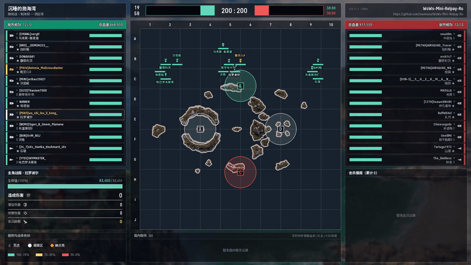

# WoWs-Mini-Relpay-Ru

[简体中文](../README.md) | [繁體中文](README.zh-TW.md) | **Русский** | [English](README.en.md)

Утилита для рендера миникарты реплеев **Мир кораблей (Lesta)** в формате `.korablireplay`.



---

## Как пользоваться

1. Скачайте `WoWs-Mini-Relpay-Ru-win64.zip` со страницы [Releases](https://github.com/starmiaoa/WoWs-Mini-Relpay-Ru/releases).
2. **Распакуйте** архив в любую папку и запустите `WoWs-Mini-Relpay-Ru.exe`.
3. Программа сама найдёт установленный клиент «Мир кораблей» (основу и Общий тест PT) и покажет список `.korablireplay` из папки `replays` (если не нашлось — укажите путь вручную кнопкой «Выбрать папку» вверху справа).
4. Отметьте нужные бои или просто перетащите файлы `.korablireplay` прямо в окно.
5. Справа выберите разрешение (по умолчанию `1920×1080`) и частоту кадров (по умолчанию `30fps`), затем нажмите **«Создать видео»**.
6. После завершения автоматически откроется папка с датой и временем — все готовые видео будут внутри.

> При первом запуске программа в фоне за пару секунд извлечёт из локального клиента карты, иконки и словарь локализации, после чего ждать больше не придётся.  
> Переключить слои на миникарте, экспорт ключевых кадров, тему или язык можно во вкладках **«Дополнительно»** и **«Настройки»**.

---

## Что делать после обновления игры или модов локализации?

Ждать новую версию программы обычно не нужно — большинство обновлений подхватывается локально:

- **После крупного патча игры**: откройте программу → вкладка **«Настройки»** → **«Пересинхронизировать клиент»** (займёт пару секунд).
- **Если обновился только мод локализации**: вкладка **«Настройки»** → **«Обновить только локализацию»** (около 1 секунды).

Если после редкого крупного изменения в протоколе разбор реплея всё же выдаёт ошибку, загляните в [UPDATING.md](../UPDATING.md) или создайте Issue и приложите свежий `.korablireplay`.

---

## Запуск из исходников и CLI

Если хотите доработать код или запускать рендер пакетно из консоли, удобнее всего использовать [uv](https://docs.astral.sh/uv/) (FFmpeg уже входит в зависимости, настраивать PATH не требуется):

```powershell
git clone https://github.com/starmiaoa/WoWs-Mini-Relpay-Ru.git
cd WoWs-Mini-Relpay-Ru
uv sync --extra dev

# 1. Запуск графического интерфейса
.\.venv\Scripts\korabli-minimap.exe gui

# 2. Синхронизация данных из локального клиента
.\.venv\Scripts\korabli-minimap.exe sync --game-dir "D:\Games\Korabli"

# 3. Рендер одного реплея через CLI
.\.venv\Scripts\korabli-minimap.exe render "D:\Games\Korabli\replays\xxx.korablireplay" `
  -o "output\battle.mp4" --resolution 1920x1080 --fps 30 --lang ru

# 4. Только разбор и просмотр статистики боя (без видео)
.\.venv\Scripts\korabli-minimap.exe inspect "D:\Games\Korabli\replays\xxx.korablireplay"

# 5. Сборка портативного EXE и релизного ZIP
.\.venv\Scripts\python.exe scripts\build_release.py

# 6. Запуск автотестов
.\.venv\Scripts\pytest.exe -v
```

---

## Благодарности

- Компоновка экрана и общая идея рендера вдохновлены [WoWs-Builder-Team/minimap_renderer](https://github.com/WoWs-Builder-Team/minimap_renderer)
- Стиль боковых ушей команд вдохновлён модом Tactical-Tech от BattleFrame
- Названия кораблей и шрифты при наличии автоматически подхватываются из установленных модов локализации (например, LocalizedKorabli)
