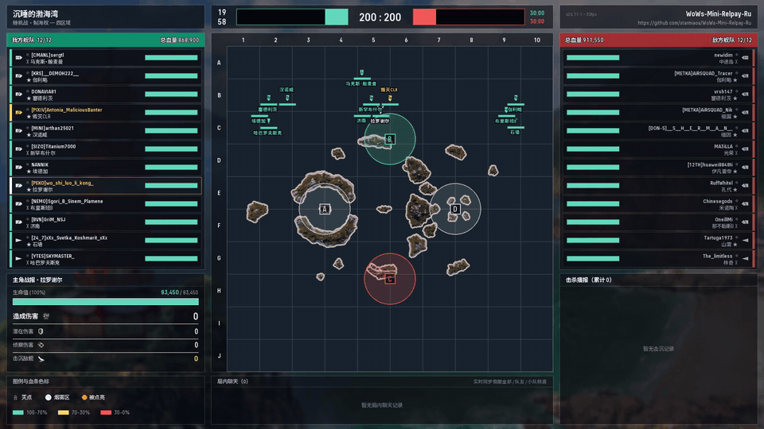

# WoWs-Mini-Relpay-Ru

[简体中文](../README.md) | **繁體中文** | [Русский](README.ru.md) | [English](README.en.md)

專為俄服《戰艦世界》（**Mir Korabley / Lesta**，`.korablireplay`）寫的小地圖重播渲染工具。



---

## 如何使用

1. 前往右側 [Releases](https://github.com/starmiaoa/WoWs-Mini-Relpay-Ru/releases) 下載 `WoWs-Mini-Relpay-Ru-win64.zip`。
2. **先解壓縮**到任意資料夾，然後雙擊 `WoWs-Mini-Relpay-Ru.exe`。
3. 打開後會自動找到你安裝的俄服正式服 / PT 測試服並列出 `replays` 裡的 `.korablireplay`（如果沒有找到，點一下右上角「選擇目錄」自己指定即可）。
4. 勾選你想產生的場次，或者把 `.korablireplay` 檔案直接拖進視窗裡。
5. 右側選好解析度（預設 `1920×1080`）和影格率（預設 `30fps`），點擊 **「開始產生」**。
6. 等進度條跑完，程式會自動打開這次按時間建好的輸出資料夾，影片都在裡面。

> 首次打開時程式會在背景順手從你本機遊戲目錄裡提取一次地圖、圖示和本地化詞庫（大概幾秒鐘），以後就不用再等了。  
> 想改圖層開關、匯出關鍵影格、換主題或語言，點頂部的 **「進階」** 或 **「設定」** 分頁即可。

---

## 遊戲更新或者中文化 mod 更新了怎麼辦？

不用等工具發新版，大多數更新在本機就能直接同步：

- **遊戲大版本更新後**：打開軟體 → 切到 **「設定」** → 點 **「重新同步目前客戶端資料」**（幾秒完成）。
- **只是更新了中文化 mod 船名**：切到 **「設定」** → 點 **「僅更新中文化詞庫」**（1 秒完成）。

如果是非常少見的底層大改導致協議解析報錯，可以參考 [UPDATING.md](../UPDATING.md) 裡的排查說明，或者直接提 Issue 並附上一場新版 `.korablireplay`。

---

## 開發者原始碼執行與命令列

如果你想改程式碼或者用命令列批次跑，推薦使用 [uv](https://docs.astral.sh/uv/)（依賴裡已經自帶獨立 FFmpeg，不需要設定系統環境變數）：

```powershell
git clone https://github.com/starmiaoa/WoWs-Mini-Relpay-Ru.git
cd WoWs-Mini-Relpay-Ru
uv sync --extra dev

# 1. 啟動圖形介面
.\.venv\Scripts\korabli-minimap.exe gui

# 2. 從本機俄服客戶端同步資料
.\.venv\Scripts\korabli-minimap.exe sync --game-dir "D:\Games\Korabli"

# 3. 命令列直接渲染單個重播
.\.venv\Scripts\korabli-minimap.exe render "D:\Games\Korabli\replays\xxx.korablireplay" `
  -o "output\battle.mp4" --resolution 1920x1080 --fps 30 --lang zh_TW

# 4. 只解析查看戰報資訊（不出影片）
.\.venv\Scripts\korabli-minimap.exe inspect "D:\Games\Korabli\replays\xxx.korablireplay"

# 5. 打包免環境綠色版 EXE 與發布壓縮包
.\.venv\Scripts\python.exe scripts\build_release.py

# 6. 執行自動化測試
.\.venv\Scripts\pytest.exe -v
```

---

## 致謝

- 畫面佈局與渲染思路參考了 [WoWs-Builder-Team/minimap_renderer](https://github.com/WoWs-Builder-Team/minimap_renderer)
- 側邊艦隊面板風格參考了 BattleFrame 的 Tactical-Tech 模組
- 中文船名與字體預設讀取玩家本機安裝的本地化 mod（如 澪刻 LocalizedKorabli）
